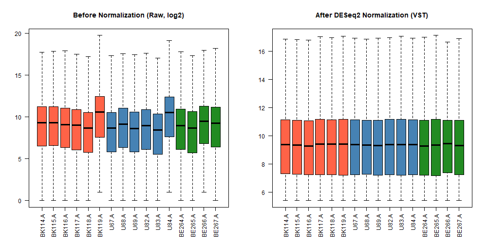
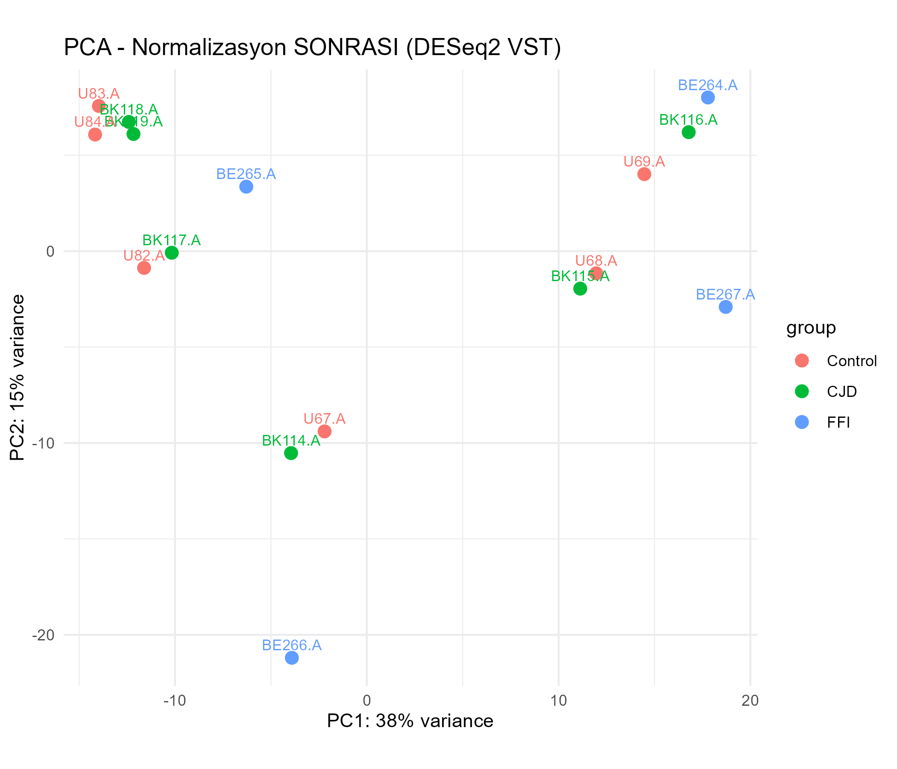

# Prion Disease – vGluT2 Nöronlarında Diferansiyel Gen İfadesi (DESeq2)

Bu repo, **GSE198063** veri setindeki ham (raw count) RNA-seq verisi kullanılarak prion hastalıklarında (**CJD** ve **FFI**) glutamaterjik (**vGluT2**) nöronlarda gen ifadesinin **kontrol** grubuna göre nasıl değiştiğini inceleyen R analiz pipeline'ını içerir.

## Amaç

Genetik prion hastalığı fare modellerinde, vGluT2 pozitif nöronlara özgü translasyon profilini (RiboTag-IP) karşılaştırarak:

- CJD ve FFI'de kontrole göre anlamlı değişen genleri belirlemek,
- CJD ve FFI arasında doğrudan karşılaştırma yapmak,
- İki hastalıkta **ortak** ve **hastalığa özgü** genleri ayırmak.

## Veri Seti

| Özellik | Değer |
|---|---|
| GEO erişim no | [GSE198063](https://www.ncbi.nlm.nih.gov/geo/query/acc.cgi?acc=GSE198063) |
| Organizma | *Mus musculus* |
| Veri türü | Ham sayım (raw count) tablosu |
| Alt küme | RiboTag-IP + vGluT2 (Slc17a6) hücre tipi + Cerebrum |
| Gruplar | Control (WT), CJD, FFI |

Ham veri script tarafından otomatik indirilir, repoya dahil edilmemiştir.

## Analiz Adımları

1. **Paket kurulumu** – GEOquery, DESeq2, org.Mm.eg.db, ggplot2
2. **Metadata ve raw count indirme** – GEO'dan örnek bilgileri ve sayım tablosu
3. **Örnek eşleştirme** – sütun adları ile GEO `description` alanı eşleştirilir
4. **Alt küme seçimi** – RiboTag-IP, vGluT2, Cerebrum örnekleri (BE268 örnekleri hariç)
5. **Gruplama** – genotipe göre Control / CJD / FFI
6. **Ön filtreleme** – ortalama sayım > 10 olan genler
7. **DESeq2** – size factor normalizasyonu, dispersiyon tahmini, Wald testi
8. **Kalite kontrol grafikleri** – normalizasyon öncesi/sonrası boxplot ve VST üzerinden PCA
9. **DEG çıkarma** – CJD vs Control, FFI vs Control, CJD vs FFI
10. **Örtüşme analizi** – ortak, sadece CJD, sadece FFI genleri
11. **Gen sembolü eşleme** – Ensembl ID → Symbol (`org.Mm.eg.db`)

## Kullanılan Eşikler

- Anlamlılık kriteri: **p-value < 0.05** (ham p-value, düzeltilmemiş)
- Log2 fold change eşiği: uygulanmadı
- Fonksiyon `kriter = "padj"` ile çağrılarak FDR düzeltmeli sonuç da alınabilir.

> **Not:** Ham p-value kullanıldığı için sonuçlar keşif amaçlıdır; çoklu test düzeltmesi yapılmamıştır.

## Sonuçlar

| Karşılaştırma | Anlamlı gen | Yukarı regüle | Aşağı regüle |
|---|---:|---:|---:|
| CJD vs Control | 233 | 131 | 102 |
| FFI vs Control | 1271 | 863 | 408 |
| CJD vs FFI | 735 | 305 | 430 |

**Örtüşme (Control'e göre):** ortak **67** gen · sadece CJD **166** gen · sadece FFI **1204** gen

## Çıktı Dosyaları

| Dosya | Açıklama |
|---|---|
| `vGluT2_CJD_vs_Control_DESeq2_RawData_pvalue.csv` | CJD vs Control DEG tablosu |
| `vGluT2_FFI_vs_Control_DESeq2_RawData_pvalue.csv` | FFI vs Control DEG tablosu |
| `vGluT2_CJD_vs_FFI_DESeq2_RawData_pvalue.csv` | CJD vs FFI DEG tablosu |
| `vGluT2_ortak_DESeq2.txt` | CJD ve FFI'de ortak genler |
| `vGluT2_sadece_CJD_DESeq2.txt` | Sadece CJD'ye özgü genler |
| `vGluT2_sadece_FFI_DESeq2.txt` | Sadece FFI'ye özgü genler |
| `GSE198063_vGluT2_before_after_normalizasyon.png` | Normalizasyon öncesi/sonrası boxplot |
| `GSE198063_vGluT2_PCA_normalizasyon_sonrasi.png` | VST sonrası PCA grafiği |

CSV sütunları: `Gene_ID`, `Symbol`, `log2FoldChange`, `pvalue`, `padj`

### Görseller




## Çalıştırma

```r
# R (>= 4.0) ve internet bağlantısı gerekir
source("yeni raw data kod.R")
```

Gerekli paketler script içinde otomatik kurulur. Script çalışma dizinine hem ham veriyi indirir hem de tüm çıktıları yazar.

## Gereksinimler

- R ≥ 4.0
- Bioconductor: `GEOquery`, `DESeq2`, `org.Mm.eg.db`
- CRAN: `ggplot2`

## Dosya Yapısı

```
Prion_Disease/
├── yeni raw data kod.R     # Ana analiz scripti
├── README.md
├── *.csv                   # DEG tabloları
├── *.txt                   # Ortak / hastalığa özgü gen listeleri
└── *.png                   # QC grafikleri
```
